# ThemerUltimate

One click re-themes the **whole desktop**: the niri compositor, Ghostty, waybar, fuzzel, mako, every Quickshell
widget (top bar, Control Panel, app launcher icons, OSDs, media, power menu, …), GTK, fastfetch and the wallpaper,
all from one JSON token file per theme. Built for a plain NixOS + niri + Quickshell rice; no home-manager, no sudo.

Four themes ship with it:

| | |
|---|---|
| **H4X0R**: phosphor green on pure black, monospace everywhere, digital rain in the terminal | **Purple Nebula**: near-black deep space, violet glow, drifting nebula clouds |
| 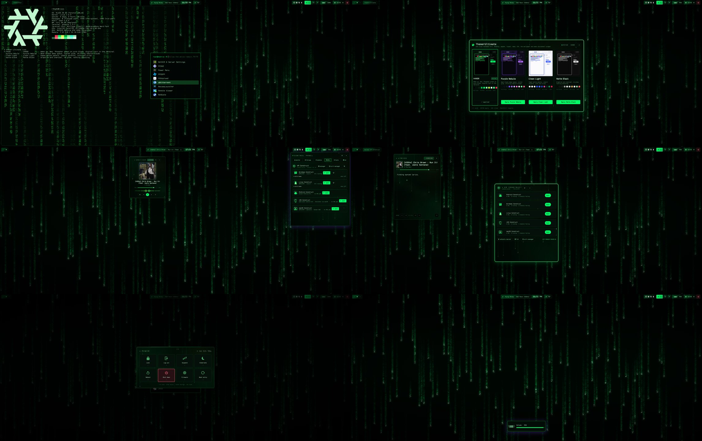 | 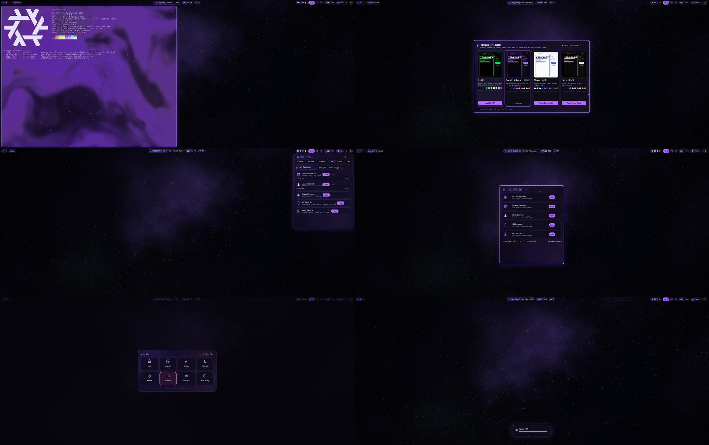 |
| **Clean Light**: paper-white panels, cobalt accents | **Matte Black**: graphite and charcoal, no glow |
| 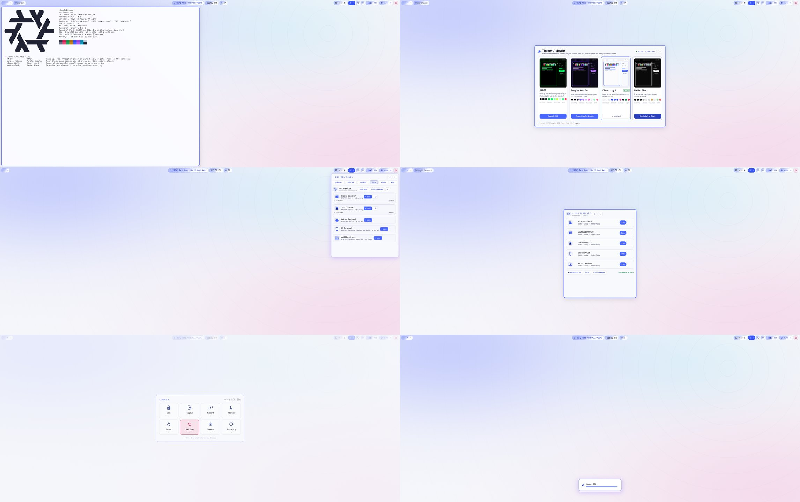 | 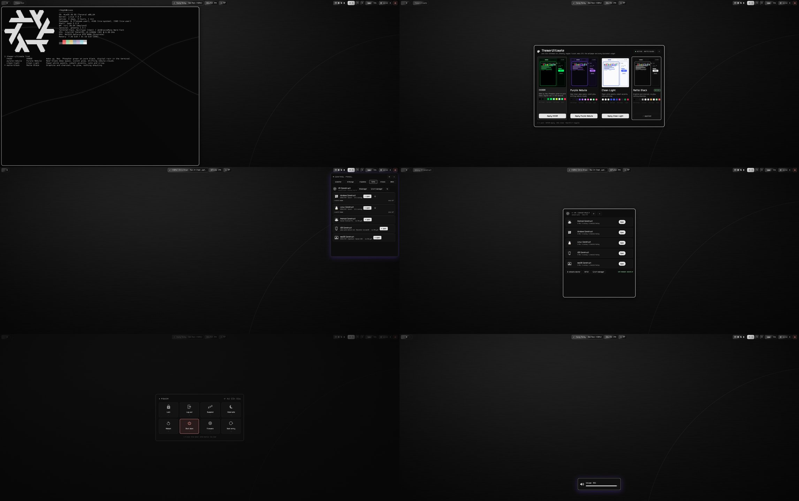 |

Each grid: Ghostty + fastfetch, the ThemerUltimate picker, the Control Panel, the VM Construct widget, the power menu and the volume OSD.

| Launcher (fuzzel, themed app icons) | | | |
|---|---|---|---|
| 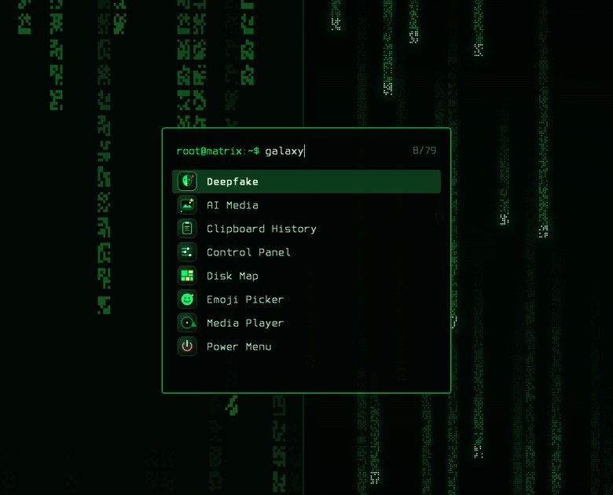 | 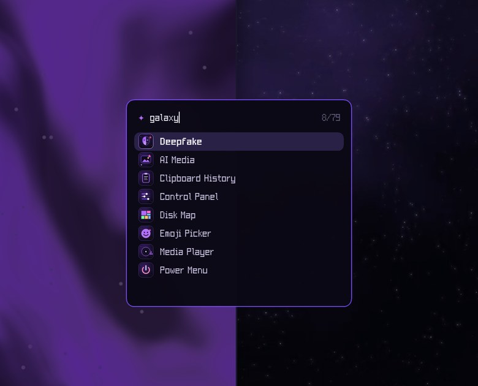 | 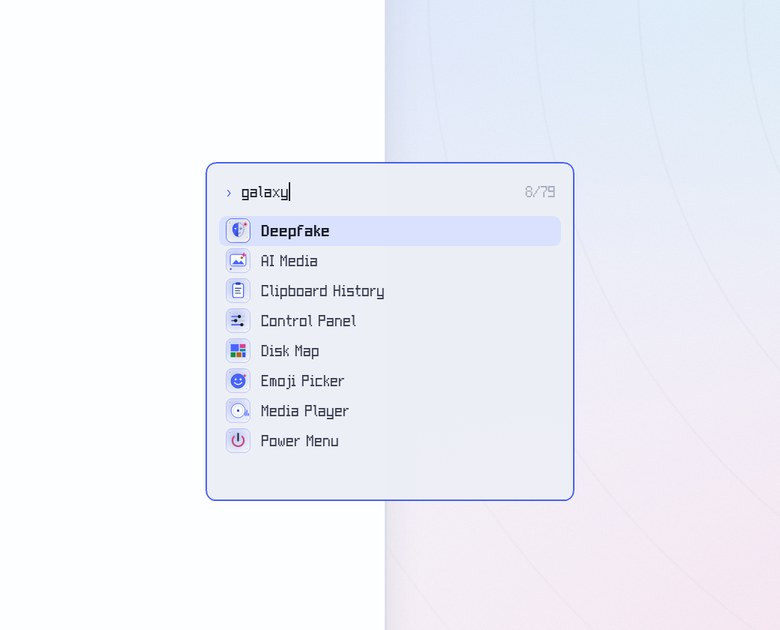 | 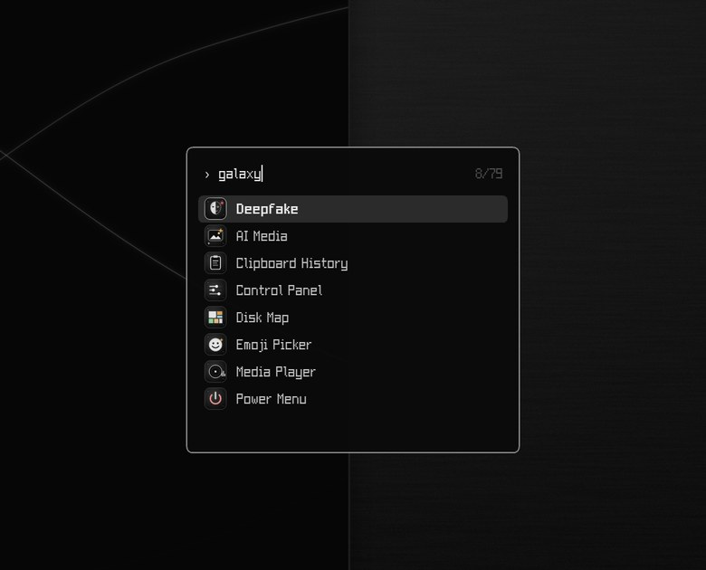 |
| 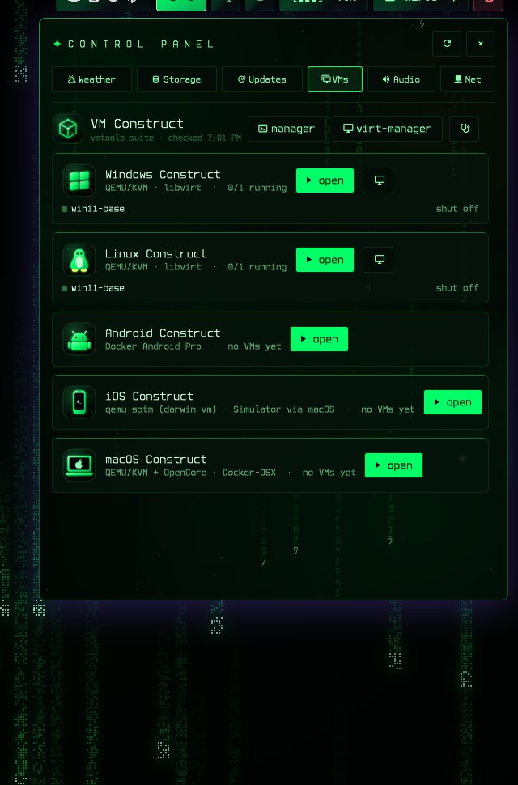 | 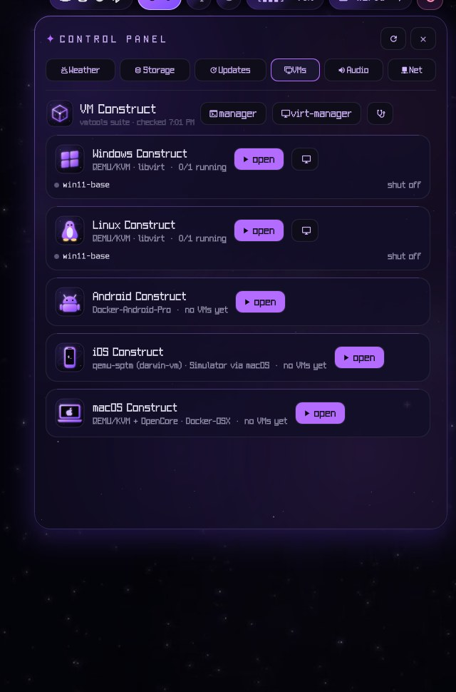 | 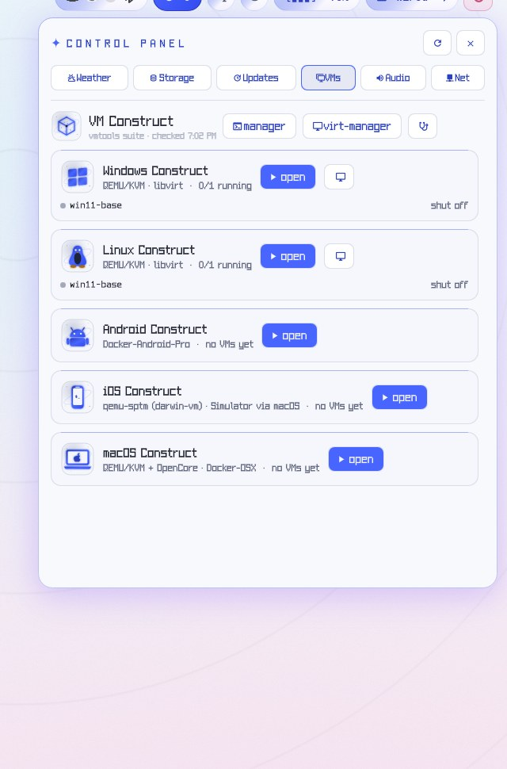 | 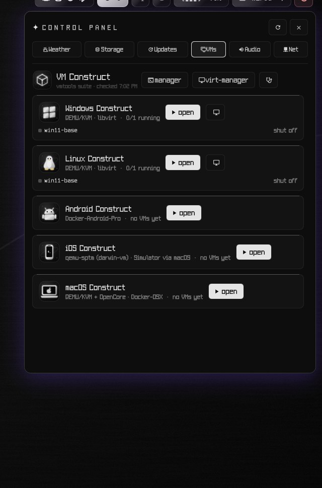 |

## Using it

* **Mod+Alt+T** toggles the picker (theme cards with swatches and a mini-mockup; click *Apply*).
* The launcher entry is called **ThemerUltimate**.
* From a shell:

```sh
themer-ultimate                    # toggle the picker
themer-ultimate list               # available themes   (--json for scripts)
themer-ultimate current            # applied theme      (--json for the full resolved theme)
themer-ultimate apply h4x0r        # apply + reload everything
themer-ultimate apply clean-light --only ghostty,waybar --dry-run
themer-ultimate next               # cycle themes
themer-ultimate get colors.primary # one resolved token
themer-ultimate render matte-black /tmp/out   # render every template without applying
```

Quickshell IPC: `qs -p ~/.config/quickshell/themer-ultimate ipc call themer open|toggle|close|next|apply <id>`.

## What a theme changes

| Component | How |
|---|---|
| **Quickshell widgets** (bar, Control Panel, OSDs, launcher-style widgets, media, power, clipboard, emoji, disk map, VM, …) | Every widget reads colours, fonts, radii and glow from a shared `Theme.qml` singleton that watches `~/.config/themer-ultimate/current.json`. Colours, corner radii, glow and nebula/rain intensity restyle **live**, without restarting anything. Per-theme glyph sets swap the OSD/volume icons (Nerd Font, Material outline, Font Awesome or ASCII bars for H4X0R). |
| **App-launcher icons** | The `galaxy-*` SVG icons are recoloured per theme into `~/.local/share/icons/hicolor/scalable/apps/` (originals are snapshotted first), so fuzzel and the widgets that show them match the palette. |
| **niri** | Focus ring gradient, borders, shadow, overview backdrop (`~/.config/niri/themer.kdl`, hot-reloaded). |
| **Ghostty** | Palette, background/foreground/cursor/selection, opacity and blur, font, and a custom shader per theme (`config-file = ?themer.conf`, SIGUSR2 reload, so open windows recolour). |
| **waybar** | `style.css` regenerated from a template, volume `format-icons` per theme, SIGUSR2 reload. |
| **fuzzel** | Colours, font, radius, prompt (`root@matrix:~$` in H4X0R). |
| **mako** | Notification colours, border and radius (`makoctl reload`). |
| **GTK 3/4** | `gtk.css` `@define-color` overrides, `gtk-application-prefer-dark-theme`, icon theme, `org.gnome.desktop.interface color-scheme`. |
| **fastfetch** | Key/title colours per theme (Purple Nebula keeps stock fastfetch). |
| **Wallpaper** | One per theme (`wallpapers/`, generated by `tools/gen-wallpapers.py`); Purple Nebula keeps the rice's live nebula video. |
| **swaylock** | `Super+Alt+L` locks on the theme's background colour. |

**Not themed, and why**

* **SDDM**: its theme lives in the root-owned NixOS config, so switching it would need `sudo nixos-rebuild` on every theme change.
* **Qt apps**: there's no qt5ct/qt6ct on a plain NixOS install. It would need `QT_QPA_PLATFORMTHEME` plus a system package; contributions welcome.
* **Cursor**: themes can set one, but the shipped themes keep the installed cursor because only one is installed.
* **Data colours** such as the disk-map category colours, emoji skin tones and screenshot pen colours stay fixed on purpose.

## Install (plain NixOS, no home-manager)

You need these in `environment.systemPackages` (most rices already have them):

```nix
environment.systemPackages = with pkgs; [
  python3 quickshell niri ghostty waybar fuzzel mako swaybg dconf papirus-icon-theme
  # optional: mpvpaper (live wallpaper), fastfetch, swaylock
];
fonts.packages = [ /* the fonts your themes name, e.g. pkgs.nerd-fonts.jetbrains-mono */ ];
```

Then, as your user (no sudo, no rebuild):

```sh
git clone https://github.com/r3dg0d/ThemerUltimate ~/src/ThemerUltimate
cd ~/src/ThemerUltimate
./install.sh --dry-run      # see what it will touch
./install.sh                # or --no-widgets to leave ~/.config/quickshell alone
```

The installer is idempotent and backs up every file it edits as `<file>.bak-themer-<timestamp>`. It:

1. Copies the app to `~/.local/share/themer-ultimate` and links `~/.local/bin/themer-ultimate`.
2. Installs the picker to `~/.config/quickshell/themer-ultimate`, plus its icon and the `ThemerUltimate` desktop entry.
3. Migrates each `~/.config/quickshell/<widget>/` to `Theme` tokens: it links `Theme.qml` and rewrites hex colours, fonts and radii with `tools/migrate-qml.py`.
4. Adds `config-file = ?themer.conf` to Ghostty and adds `include "themer-app.kdl"` (window rule + **Mod+Alt+T**) and `include "themer.kdl"` to niri, then validates the niri config.
5. Applies the current theme (Purple Nebula on a fresh install).

Make sure `~/.local/bin` is on your `PATH`. The fonts named in the themes (Cellforge, Zerodot, NullType, JetBrainsMono Nerd Font) are what this rice uses. Change `fonts` in a theme file to anything you have installed.

**Uninstall:** restore the `.bak-themer-*` files, then remove `~/.local/share/themer-ultimate`, `~/.local/bin/themer-ultimate` and `~/.config/themer-ultimate`.

## Adding a theme

1. Copy `themes/matte-black.json` to `themes/<id>.json` and set `id`, `name`, `tagline`, `mode` (`dark`/`light`) and `order`.
2. Set the 25 core colours in `colors` (`void base surface raised window sel line edge edgeHot accent primary light hot ink bright text2 muted label dim ok warn err red pink cyan`). `tokens.json` documents each one. The other ~30 tokens (tiles, rims, soft text, status backgrounds…) are derived with `["mix", a, b, t]` unless you override them.
3. Optional sections:
   * `fonts`: `ui`, `led`, `code`, `icons`, `terminal`, `terminalSize`.
   * `shape.radiusScale` / `shape.pill`.
   * `glow`: `nebula`, `stars`, `rim`, `rain`, `shadow`.
   * `terminal`: 16-colour palette, `opacity`, `blur` and `shader`, a file in `shaders/`.
   * `focusRing`, `wallpaper`, `iconTheme`, `gtk.preferDark` and `fastfetch`.
   * `launcher.prompt` and `glyphs`: per-icon overrides for OSDs and the bar.
4. Run `themer-ultimate render <id> /tmp/x` to check the output, then `themer-ultimate apply <id>`. It shows up in the picker automatically.

Theme files are also picked up from `~/.config/themer-ultimate/themes/`, so you can keep your own themes out of the repo.

Templates live in `templates/` and use `{{colors.primary}}`, `{{fonts.ui}}` and similar placeholders. Writing to Quickshell, in either direction, goes through `Theme.c("token")`, `Theme.a(color, alpha)`, `Theme.r(radius)` and `Theme.glyph(name, fallback)`.

## Layout

```
bin/themer-ultimate   CLI (Python stdlib only)
themes/*.json         one token file per theme      tokens.json   token reference + derivations
templates/            waybar, fuzzel, mako, ghostty, niri, gtk
qml/                  Theme.qml singleton (generated by tools/gen-theme-qml.py), Nebula.qml backdrop
app/                  the picker (Quickshell)       icons/, share/  launcher icon + desktop entry
shaders/              Ghostty shaders               wallpapers/   per-theme wallpapers
tools/                migrate-qml.py, templatize.py, gen-wallpapers.py, gen-theme-qml.py, shoot.sh
```

## Credits

The Ghostty shaders (`nebula-purple.glsl`, `matrix-rain.glsl`, `oled-black.glsl`) come from
[**ghostfx**](https://github.com/r3dg0d/ghostfx) (MIT, © GhostFX Contributors, notice in `shaders/LICENSE-ghostfx`). Matrix rain and OLED black are retuned per theme.

## License

MIT © 2026 r3dg0d (see [LICENSE](LICENSE))
